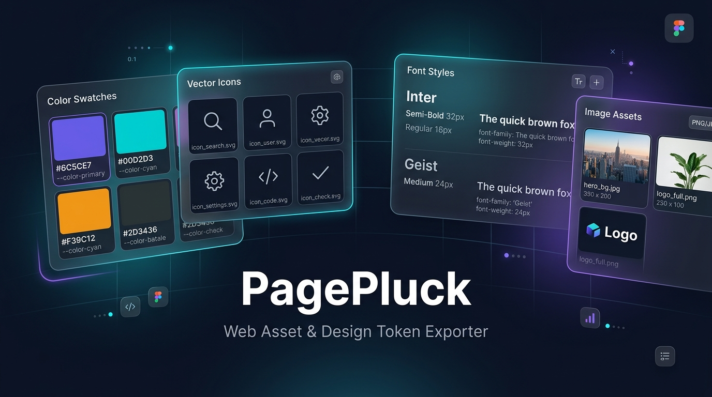

# PagePluck — Web Asset & Design Token Exporter

> A modern, local-only Chrome Extension to inspect, pluck, and export images, inline SVGs, CSS backgrounds, color palettes, and fonts from any webpage directly in your side panel.

<p align="center">
  
</p>

<p align="center">
  <a href="https://github.com/hetkumar5506/pagepluck/stargazers"></a>
  <a href="https://github.com/hetkumar5506/pagepluck/network/members"></a>
  <a href="https://github.com/hetkumar5506/pagepluck/blob/main/LICENSE"></a>
  <a href="https://wxt.dev/"></a>
  <a href="https://react.dev/"></a>
  <a href="https://www.typescriptlang.org/"></a>
</p>

**PagePluck** is a high-performance, developer- and designer-friendly browser extension built on Manifest V3. Designed as a Chrome side panel, it lets you inspect any live webpage and pluck out design tokens, vector graphics, image assets, color swatches, and typography styles without digging into complex DevTools element trees.

🛡️ **100% Local & Privacy-First**: No remote API calls, no analytics trackers, no databases, and no account requirements. Everything executes inside your local browser context.

---

## 📑 Table of Contents

- [Why PagePluck?](#-why-pagepluck)
- [Key Features](#-key-features)
- [How It Works](#-how-it-works)
- [Tech Stack & Architecture](#-tech-stack--architecture)
- [Installation & Quick Start](#-installation--quick-start)
- [Usage Guide](#-usage-guide)
- [Available Commands](#-available-commands)
- [Testing & Quality Assurance](#-testing--quality-assurance)
- [Project Architecture](#-project-architecture)
- [Security & Permissions](#-security--permissions)
- [Contributing](#-contributing)
- [License](#-license)

---

## 💡 Why PagePluck?

When inspecting websites for design research, asset recovery, or frontend development, extracting assets manually through browser DevTools is tedious:
- Inspecting and copying raw SVG markup from nested DOM trees takes time.
- CSS background images and sprite sheets are hidden behind deep style rules.
- Color palettes and font families are scattered across multiple CSS stylesheets.

**PagePluck solves this instantly**: Click the extension icon to reveal all assets categorized cleanly in your browser side panel.

---

## ✨ Key Features

### 🖼️ Image & Media Downloader
- Detects all HTML `` elements, `<video>` posters, and CSS `background-image` declarations.
- Intelligent CSS sprite sheet inspection with support for single-crop exports.
- Supports batch download and single-click saves.

### ⚡ Inline SVG Icon Extractor
- Discovers and serializes inline `<svg>` elements on the fly.
- Previews SVG icons safely inside the side panel cards.
- Exports pure `.svg` files ready for Figma, Sketch, or codebase integration.

### 🎨 Color Palette & Hex Picker
- Ranks computed foreground, background, and border colors by frequency of use across the DOM.
- Instant click-to-copy in HEX or RGB formats.
- Visual swatch previews for rapid theme auditing.

### 🔤 Font & Typography Inspector
- Scans computed `font-family` declarations across all rendered text.
- Displays element usage counts and live interactive typography preview samples.

### 🖥️ Persistent Side Panel Workflow
- Powered by the Chrome `sidePanel` API: inspect the page while actively scrolling, clicking, and interacting with the target site.

---

## 🔬 How It Works

```text
Target Webpage DOM
       │
       ▼
 WXT Content Script (Isolated Context)
       ├── Scans up to 5,000 DOM elements
       ├── Extracts , SVG, and CSS background assets
       ├── Aggregates & deduplicates computed colors & fonts
       │
       ▼ (runtime message: SCAN_PAGE)
 React 19 Side Panel UI
       ├── Instant search, preview, and filtering
       ├── Click-to-copy color tokens
       └── Download assets individually or in batches
```

---

## 🛠️ Tech Stack & Architecture

- **Framework**: [WXT](https://wxt.dev/) (Next-generation Chrome Extension framework for Manifest V3)
- **UI Library**: [React 19](https://react.dev/)
- **Language**: [TypeScript](https://www.typescriptlang.org/) (Strict mode enabled)
- **Styling**: [Tailwind CSS v4](https://tailwindcss.com/)
- **Micro-Animations**: [Motion](https://motion.dev/)
- **End-to-End Testing**: [Playwright](https://playwright.dev/) running in real Chromium

---

## 🚀 Installation & Quick Start

### Prerequisites
- **Node.js**: `>= 22.0.0`
- **npm**: `>= 10.0.0`
- Google Chrome, Brave, Arc, Edge, or any Chromium browser.

### 1. Clone the repository
```bash
git clone https://github.com/hetkumar5506/pagepluck.git
cd pagepluck
```

### 2. Install dependencies
```bash
npm install
```

### 3. Run development build
```bash
npm run dev
```
WXT will watch source files and compile the extension into `.output/chrome-mv3`.

### 4. Load the extension in Chrome
1. Open Chrome and navigate to `chrome://extensions`.
2. Enable **Developer mode** using the toggle switch in the top-right corner.
3. Click **Load unpacked**.
4. Select the `.output/chrome-mv3` folder inside the `pagepluck` directory.
5. Pin **PagePluck** from the Chrome extension puzzle piece menu.

---

## 📖 Usage Guide

1. Open any standard website (e.g. `https://github.com` or `https://unsplash.com`).
2. Click the **PagePluck** icon in your toolbar.
3. The Chrome side panel opens automatically.
4. Switch between the tabs:
   - **Images**: Browse raster assets, posters, and background images.
   - **SVGs**: Preview icons and download individual vector files.
   - **Colors**: Click any swatch to copy its HEX value to your clipboard.
   - **Fonts**: View typography stacks utilized across the site.
5. Click **Rescan** anytime if dynamic content loads or after navigating to another page.

> **Note**: Chrome restricts extension scripts on internal pages such as `chrome://`, `edge://`, `about:blank`, and the Chrome Web Store.

---

## 💻 Available Commands

| Command | Purpose |
| --- | --- |
| `npm run dev` | Start development mode with HMR and automatic extension reloads |
| `npm run build` | Produce an optimized production build in `.output/chrome-mv3` |
| `npm run typecheck` | Run TypeScript compiler type validation (`tsc --noEmit`) |
| `npm run test:e2e` | Launch real Chromium with Playwright to verify asset extraction |
| `npm run check` | Run typecheck, E2E tests, and dependency security audits |
| `npm run zip` | Bundle the production extension into a store-ready `.zip` package |
| `npm run clean` | Remove `.output`, `.wxt`, and test reports |

---

## 🧪 Testing & Quality Assurance

PagePluck includes an automated Playwright suite verifying DOM extraction, background image parsing, SVG serialization, and side panel messaging in a headless Chromium environment:

```bash
# Install Chromium browser binary (first time only)
npx playwright install chromium

# Run the test suite
npm run test:e2e
```

---

## 📁 Project Architecture

```text
pagepluck/
├── entrypoints/
│   ├── background.ts          # Service worker managing side panel toggle
│   ├── content.ts             # DOM content script for asset harvesting
│   └── sidepanel/             # React application mounted in Chrome side panel
│       ├── App.tsx            # Main state, tab controls, filtering & downloads
│       ├── index.html         # Side panel shell
│       ├── main.tsx           # React DOM root
│       └── style.css          # Design system & CSS rules
├── lib/
│   └── types.ts               # Shared TypeScript models and IPC contracts
├── public/
│   └── icon/                  # Extension icons (16px, 32px, 48px, 128px)
├── assets/brand/              # Vector and high-res master branding
├── test-pages/                # Controlled HTML fixtures for testing edge cases
├── tests/                     # Playwright integration & E2E tests
├── docs/                      # Architectural audits and developer notes
├── wxt.config.ts              # Manifest V3 metadata & build configs
├── tsconfig.json              # Strict TypeScript configuration
├── LICENSE                    # MIT License
└── package.json               # Dependencies and build scripts
```

---

## 🔒 Security & Permissions

PagePluck is built strictly following the principle of least privilege:

| Permission | Reason |
| --- | --- |
| `sidePanel` | Allows rendering the user interface alongside the active browser tab |
| `downloads` | Saves selected images and SVG files to your local `Downloads` directory |
| `<all_urls>` | Required to inspect DOM elements, inline SVGs, and computed styles on arbitrary pages |

- **Zero Network Egress**: The extension contains no network request logic (`fetch`, `XMLHttpRequest`, WebSockets, or beacons).
- **Ephemeral State**: Extracted data remains strictly in React memory and is cleared when the side panel is closed.

---

## 🤝 Contributing

Contributions are welcomed! Whether you want to fix a bug, suggest an enhancement, or optimize performance:

1. Fork this repository.
2. Create your branch: `git checkout -b feature/my-new-feature`.
3. Test your changes: `npm run check`.
4. Commit your changes: `git commit -m 'feat: add support for webp conversion'`.
5. Push to the branch: `git push origin feature/my-new-feature`.
6. Open a Pull Request on GitHub.

---

## 📄 License

This project is licensed under the [MIT License](LICENSE) © 2026 Het Patel.
